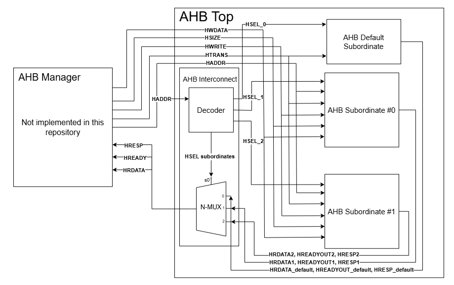
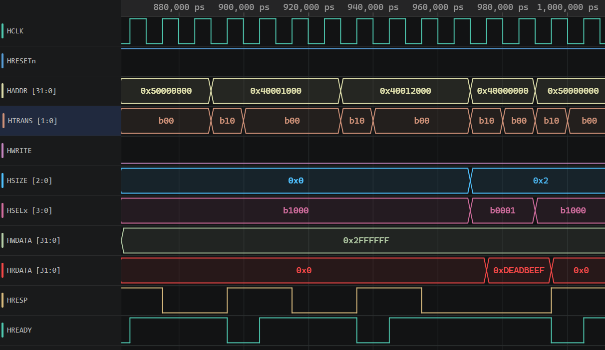

# SystemVerilog AMBA 3 AHB-Lite Master Controller

A modular, parameterizable **AMBA 3 AHB-Lite Master Interface** written in SystemVerilog. Designed to connect generic memory requests to standard AHB-Lite bus interconnect and subordiantes with full stall management, address-phase pipeline logic, and error handling.

---

## System Architecture



*Figure 1: Parameterized AHB-Lite Interconnect with dynamic address decoding, N-MUX response routing, and Default Subordinate fallback handling.*

---

## Features
* **AMBA 3 AHB-Lite Compliance:** Implements standard `HTRANS`, `HADDR`, `HWRITE`, `HSIZE`, `HRDATA`, `HWDATA`, `HREADY`, and `HRESP` signals. 
* **Dynamic Subordinates:** Allows for parameterizable number of subordinates and subordinate sizes by modifying the AHB_pkg.sv file.
* **Pipelined Bus Protocol:** Decouples address and data phases to support full single-cycle throughput without insertable wait-states.
* **Stall & Ready Handling:** Safely pauses CPU/Master requests when target subordinates assert wait states (`HREADY = 0`).
* **Error Recovery:** Detects subordinate error conditions (`HRESP = 1`) and flags fault states to the manager.
* **Transfer Width:** Multi-size support (`HSIZE`) for Byte, Half-Word, and Word access alignment.
* **Verification-Ready:** Structured for seamless binding with SystemVerilog Assertions (SVA) to monitor protocol compliance.

---

## Signals and Interface Summary

### System Signals
| Signal | Direction | Description |
| :--- | :--- | :--- |
| `HCLK` | Input | System Clock |
| `HRESETn` | Input | Active-Low Asynchronous Reset |

### Master Output Signals (AHB Bus)
| Signal | Width | Description |
| :--- | :--- | :--- |
| `HADDR` | 32-bit | Byte address of the transfer |
| `HTRANS` | 2-bit | Transfer type (`IDLE` = 2'b00, `BUSY` = 2'b01, `NONSEQ` = 2'b10), `SEQ` = 2'b11 |
| `HWRITE` | 1-bit | Read (0) or Write (1) indication |
| `HSIZE` | 3-bit | Transfer size (Byte = 3'b000, Half-word = 3'b001, Word = 3'b010) |
| `HWDATA` | 32-bit | Write data bus (driven during Data Phase) |

### Slave Input Signals (AHB Bus)
| Signal | Width | Description |
| :--- | :--- | :--- |
| `HRDATA` | 32-bit | Read data bus |
| `HREADY` | 1-bit | Slave ready indicator (high when transfer complete) |
| `HRESP` | 1-bit | Slave transfer response (0 = OKAY, 1 = ERROR) |

---

## Bus Timing & Phase Behavior

The module manages the mandatory 2-phase AHB-Lite protocol overlapping:

```text
               Cycle 1       Cycle 2       Cycle 3
             +-------------+-------------+-------------+
HCLK         |  _  ¯¯¯  _  |  _  ¯¯¯  _  |  _  ¯¯¯  _  |
             +-------------+-------------+-------------+
HADDR        |   Address A |   Address B |    ...      |
             +-------------+-------------+-------------+
HTRANS       |   NONSEQ    |   NONSEQ    |    ...      |
             +-------------+-------------+-------------+
HWDATA/HRDATA|    (Idle)   |   Data A    |   Data B    |
             +-------------+-------------+-------------+
```

## Parameterized & Dynamic Interconnect Architecture

The interconnect topology, address space allocation, and multiplexer routing dynamically scale based on configuration constants defined in `RTL/AHB_pkg.sv`. 

### Key Package Parameters (`AHB_pkg.sv`)
```systemverilog
package AHB_pkg;
    // Number of active user subordinates (excluding default handler)
    parameter int NUM_SUBORDINATES = 3;

    // Base memory addresses for each subordinate
    parameter logic [31:0] BASE_ADDR [NUM_SUBORDINATES] = '{
        32'h4000_0000, 
        32'h4001_0000, 
        32'h4002_0000
    };

    // Amount of memory each subordinate holds
    parameter logic [31:0] ADDR_SIZE [NUM_SUBORDINATES] = '{
        32'h0000_1000, 
        32'h0000_2000, 
        32'h0000_4000
    };
endpackage
```

## Verification & Test Results

---
Verification is executed using Verilator with an 11-stage comprehensive self-checking SystemVerilog testbench (`TB/AHB_TOP_TB.sv`) and protocol assertions (`SVA/AHB_lite_checker.sv`).

### Waveform Analysis: 2-Cycle Error Response



*Figure 2: Waveform snippet demonstrating the 2-cycle HRESP error sequence when accessing unmapped address space (TEST 6 & 7).*

### Simulation Output
```text
--- TEST 0: reset state and instance parameters ---
--- TEST 1: word reads ---
--- TEST 2: back-to-back different subordinates ---
--- TEST 3: halfword writes ---
--- TEST 4: byte writes ---
--- TEST 5: read size independence ---
--- TEST 6: unmapped ERROR ---
--- TEST 7: error recovery ---
--- TEST 8: region aliasing ---
--- TEST 9: cross-subordinate isolation ---
--- TEST 10: IDLE and BUSY must not transfer ---
=== ALL TESTS PASSED ===
- TB/AHB_TOP_TB.sv:370: Verilog $finish
- Verilator: $finish at 2us; walltime 0.004 s
```
---

### Running the Verification Suite

**Prerequisites:** Verilator v5.000+ (compiled with `--timing` support).

Execute the full 11-stage verification suite locally:

```bash
# Compile design and testbench
verilator --binary --timing --top AHB_TOP_TB -f filelist.f

# Run simulation
./obj_dir/VAHB_TOP/TB
```

